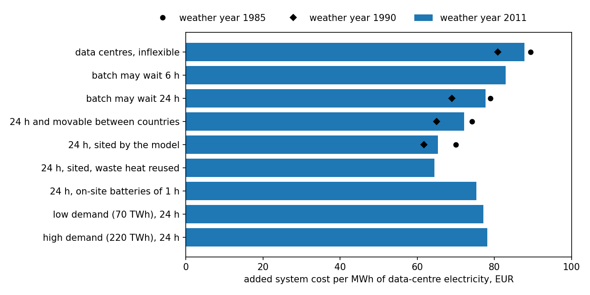
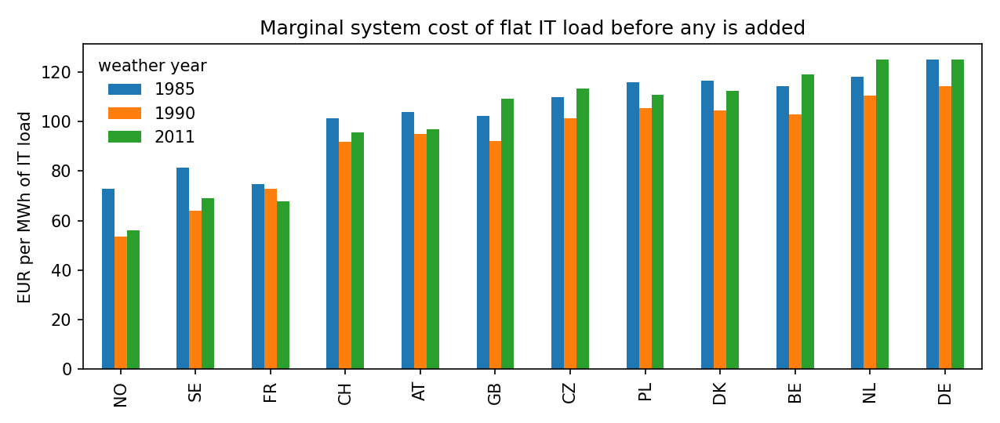
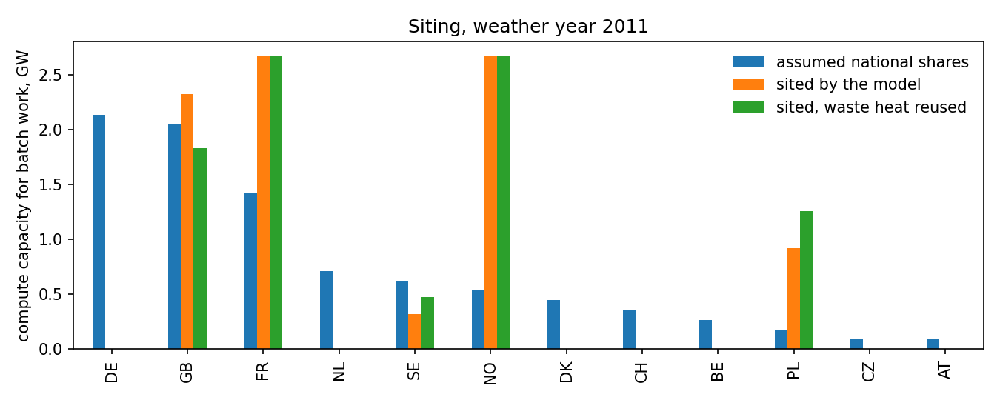

# A digitalisation module for energy system models

What do new data centres, digital control of demand and digital working practices cost or save in a renewable power system, where do they matter most and how can they be written into established energy system models?

This is a small, stylised research study. All data-centre, digital-control and working-practice parameters are assumptions.

## What the module does

| Element | Representation |
|---|---|
| Interactive computing | stays in its country, follows a daily profile |
| Batch computing | may wait (a backlog limited in volume), move between countries (one common pool) or be sited by the model |
| Cooling | power usage effectiveness (PUE) from hourly outdoor temperature |
| Waste heat | revenue in the heating months, limited by an assumed district heating share |
| On-site batteries | open to the grid, hours of the average data-centre load, cost not counted |
| Digital control of demand | a share of national demand can be shifted within 8 hours; the digital system uses electricity itself |
| More work at home | an hourly change of demand on working days |
| Link to TIMES | the data-centre processes as a TIMES data file, run in the open TIMES demo |

The host model is a capacity expansion of 12 northwestern European countries in PyPSA (the base model of [eu-weather-years-pypsa](https://github.com/serikov-energy-systems/eu-weather-years-pypsa)): wind, solar, batteries and a costly dispatchable backup are optimised, nuclear and hydro exist, countries are joined by a transport model.

## Results

Added data-centre electricity: 130 TWh a year at a PUE of 1.25 (about 121 TWh with the temperature-dependent PUE). 40% of the computing is batch work. Added system cost against the same system without it:

| Case | Weather year 2011, bn EUR/a | EUR per MWh | Mean of 1985, 1990, 2011, bn EUR/a (range) |
|---|---|---|---|
| inflexible | 10.65 | 88 | 10.41 (9.79-10.79) |
| batch may wait 6 h | 10.05 | 83 | |
| batch may wait 24 h | 9.42 | 78 | 9.10 (8.35-9.53) |
| 24 h and movable between countries | 8.75 | 72 | 8.53 (7.88-8.95) |
| 24 h, sited by the model | 7.93 | 65 | 7.95 (7.46-8.44) |
| 24 h, sited, waste heat reused | 7.82 | 64 | |
| 24 h, on-site batteries of 1 h | 9.14 | 75 | |
| 70 TWh, 24 h | 5.04 | 77 | |
| 220 TWh, 24 h | 16.04 | 78 | |



- **Flexibility in time, in space and in siting each lower the cost, in the same order in all three weather years.** On the three-year mean, waiting up to 24 hours saves 1.31 bn EUR a year (13% of the added cost), moving work between countries a further 0.57 bn and choosing the sites a further 0.58 bn.
- **Flexibility replaces firm energy.** The added backup generation falls from 6.7 TWh (inflexible) to 4.2, 3.7 and 2.3 TWh on the three-year mean. Less battery capacity is built than for inflexible load.
- **The cost per MWh hardly depends on the volume** between 70 and 220 TWh (77-78 EUR).
- **Where.** Before any load is added, one more MWh of flat computing costs the system 53-75 EUR in Norway and France and 114-125 EUR in Germany (three weather years). In every year the siting case puts the largest parts in France and Norway, at or within 1% of the allowed 30% each.
- **On-site batteries** of one hour of average load (about 15 GWh in total) save 0.29 bn EUR a year on top of 24-hour waiting, and 13 GWh less grid battery capacity is built. The saving is what such batteries would be worth to the system, before their cost.
- **Waste heat** is worth little here (0.11 bn EUR a year) at the assumed heat value and district heating shares.
- **Digital control of demand**: making 2% or 5% of demand shiftable saves 0.67 or 1.61 bn EUR a year, net of the electricity of the digital system but without its hardware and software cost. The figure is therefore an upper bound on what such a system may cost.
- **More work at home** raises system cost by 0.15 bn EUR (0.58 bn with less office saving) because the assumed change moves demand from midday towards mornings and evenings.





## Link to TIMES

`digienergy.times_link` writes the data centres as TIMES processes (interactive service, batch work with a capacity bound per time slice, optional time slice storage, efficiency 1/PUE per time slice). `scripts/times_demo.py` adds them to the open two-region [TIMES demo](https://github.com/etsap-TIMES/TIMES_Demo), reduced to the milestone years 2005 and 2030 to fit the GAMS demo licence, with data-centre electricity of 3% of each region's 2030 electricity output.

| Case | Discounted system cost, MEUR2005 | Added by data centres | PUE region 1 / region 2 |
|---|---|---|---|
| demo without data centres | 15,210,943 | | |
| data centres, rigid | 15,246,521 | 35,578 | 1.171 / 1.159 |
| data centres, batch storage | 15,246,472 | 35,528 | 1.169 / 1.158 |

With storage the batch work moves to the night up to the compute capacity bound. It saves only 49 MEUR (0.14% of the added cost) because the electricity price of this demo is the same in all time slices, so only the cooling gain remains. The value of flexibility needs a TIMES model with time-dependent prices; the PyPSA results above cannot be transferred to it. The link is one way: the TIMES run does not feed back into the PyPSA model.

## Run

The inputs of the host model come from the base repository: clone it next to this one, run its `scripts/download_data.py` and add `buses.csv`, `lines.csv` and `powerplants.csv` as described there (or point `DIGI_DATA` to the folder).

```
pip install -e ".[test]"
python -m digienergy.run            # 24 capacity expansions, about 5-10 minutes each, cached in results/runs
python -m digienergy.run report
python scripts/check_weeks.py 26    # sensitivity to the number of representative weeks
pytest -q
```

The TIMES run needs GAMS, a clone of TIMES_Demo and the package `gamsapi`:

```
TIMES_DEMO=../TIMES_Demo GAMS=/path/to/gams python scripts/times_demo.py
```

The solver is Clarabel, called directly on the matrices that PyPSA builds (`digienergy/solve.py`): capacity variables that enter every time step are split into chains of copies, which keeps the factorisation sparse. A test compares cost and prices with HiGHS on a small system.

## Representative weeks

Costs depend on which weeks are chosen. For the system without new demand in 2011:

| Resolution | System cost, bn EUR/a |
|---|---|
| 13 weeks, 3-hour step (used here) | 101.9 |
| 26 other weeks, 3-hour step | 88.0 |
| full year, 6-hour step (base repository, HiGHS) | 92.1 |

The 13-week sample is about 11% above the full-year figure for 2011 (3% for 1985 and 6% for 1990), so the absolute costs here are not a good estimate of the full-year system. The comparison of cases rests on differences of runs that share the same weeks.
How far the differences themselves depend on the sample of weeks has not been verified.

## Assumptions and limits

- Every fourth week of a year (13 weeks) at a 3-hour step, run in sequence and scaled to a year. Seasonal storage is compressed accordingly, and rare long windless spells can be missed.
- Greenfield wind, solar and battery capacity at 2030 cost assumptions; no hydrogen storage; backup at an assumed 200 EUR/MWh; transport model between countries without grid expansion; demand of 2018.
- Data-centre volume, national shares, batch share, headroom, PUE curve, district heating shares, heat value, the shiftable share, the electricity of the control system and the work-at-home profile are assumed. None is a forecast.
- The waiting limit bounds the volume of delayed work (hours of average batch work), not the deadline of each job. No latency, data transfer cost, data sovereignty or grid connection limits.
- The siting result depends on the 30% limit per country and on the transport model; it is no recommendation for a location.
- Waste heat revenue has no heat demand model.
- Three weather years (median, costliest and cheapest of the base study); the other cases use the median year only.
- The TIMES demo is a hypothetical system; its regions borrow German and Swedish temperatures.

## Data and licences

Capacity factors from renewables.ninja and load from ENTSO-E through Open Power System Data (CC BY-NC 4.0 for the capacity factors); costs from PyPSA technology-data; grid from the PyPSA-Eur prebuilt network; power plants from powerplantmatching; temperature from ERA5 through [Open-Meteo](https://open-meteo.com/) (CC BY 4.0, files in `data/`); TIMES demo by IEA-ETSAP (model data CC BY 4.0, source GPLv3, neither is redistributed here).
